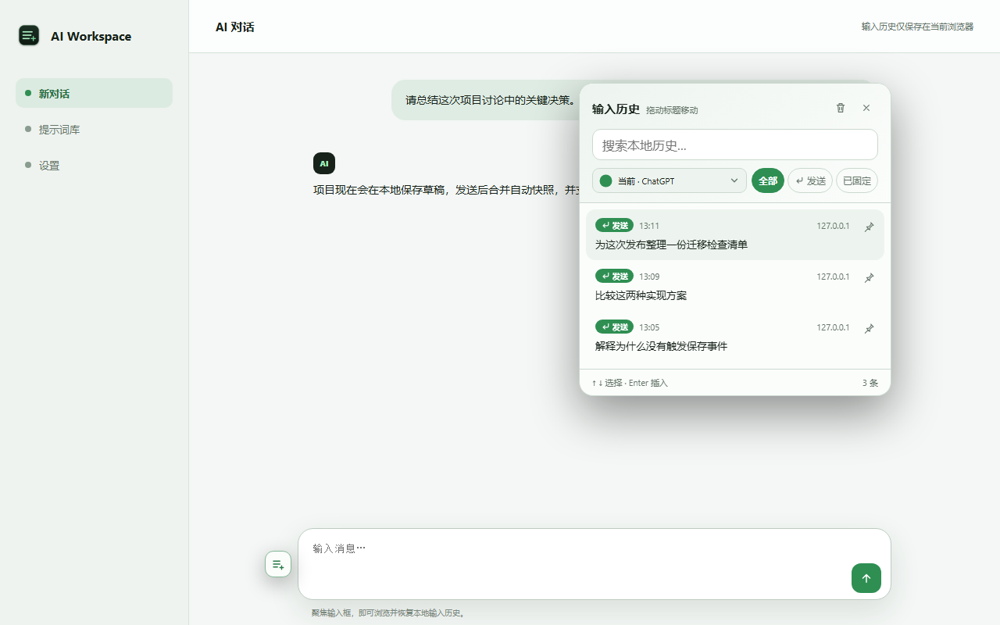
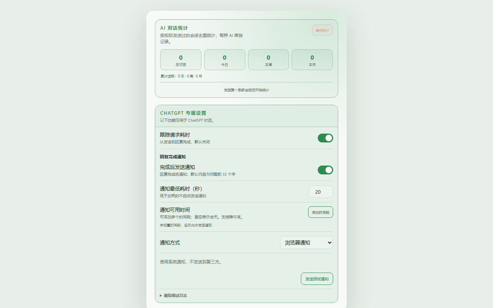
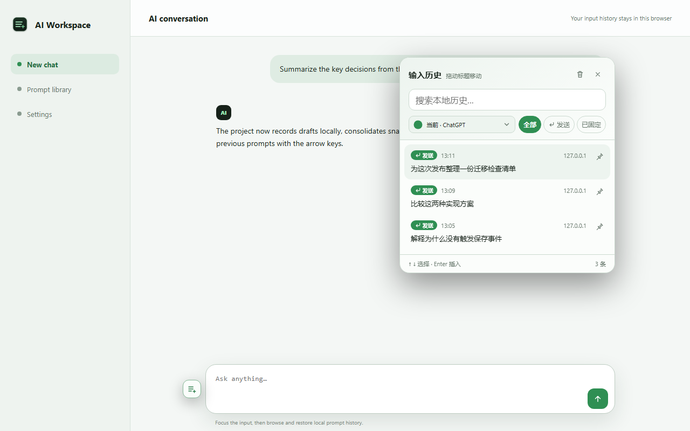
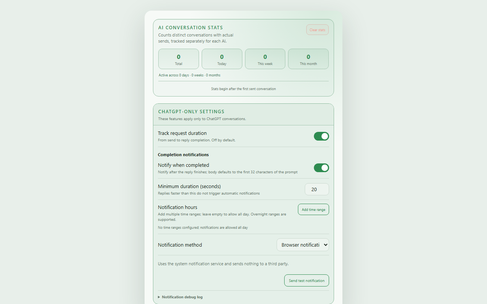

# AI 输入历史

面向 Chrome、Edge 等 Chromium 浏览器的 Manifest V3 扩展。它会识别网页中的聊天输入框，将草稿、定时快照和实际发送前的内容保存在 `chrome.storage.local`。输入历史默认不上传；只有用户主动启用第三方或自定义回复完成通知时，才会向所配置的通知服务发送通知内容。

## 1.37.16 开启 Pro 计数时自动读取账号套餐

在扩展设置中将「记录 Pro 模型次数」从关闭切为开启，开关保存成功后立即复用「读取当前账号套餐」功能。优先读取当前已登录的 ChatGPT 标签页；也保留原有的其他 ChatGPT 标签页回退与手动读取按钮。能够确认档位时自动填入并保存，未打开 ChatGPT、未登录或读取失败时保留原套餐，不关闭计数、不清零历史。

只对用户主动的关闭 → 开启操作触发；打开设置、刷新网页、关闭开关或同步其他设置不会重新查询。连续触发自动和手动读取共用在途请求；关闭开关或读取途中手动选择套餐后，迟到的自动结果不会覆盖用户决定。具体规则仍使用现有识别逻辑，不使用账单、不保存账号原始信息。Pro 按钮内的 `(15)` 与无悬停提示样式不变。

**新功能使用说明：** [ChatGPT Pro 模型次数与套餐自动识别指南](docs/pro-usage-guide.md)（开启步骤、模型按钮内的 `(N)`、自动/手动套餐识别、统计重置、错误排查及隐私范围）。

验证与操作记录见 [v1.37.16 自动套餐读取验收](docs/quality-review-1.37.16.md)。

## 1.37.15 Pro 模型按钮内部嵌入括号次数（移除提示）

按真实登录 ChatGPT 页面结构，将 `(15)` **放在输入框右侧原生「Pro ▾」模型选择按钮的内部**，呈现为 `Pro (15) ▾`，括号小数字略低于 Pro 文本基线，而不再贴在按钮右下方的外面。插件自动在原有 Pro 与箭头之间预留适当的 flex 间距，点击该数字的屏幕位置仍会触发 ChatGPT 原生模型按钮；不向 React 管理的按钮添加子节点，卸载、关掉 Pro 计数或切到其他模型时恢复原始间距，React 重建按钮也不会重复撑宽。

**不再提供插件额外提示**：移除浮动数字的 `title`、键盘聚焦入口和额外无障碍提示，悬停不弹出插件用量说明，纯展示小灰字。剩余数的统计逻辑和本机配置保持不变；不能确定具体数字时仍用 `(?)`，仅代表上限时用 `(≤N)`，不会把上限冒充精确额度。具体实测见 [1.37.15 按钮内部显示验收](docs/quality-review-1.37.15.md)。

## 1.37.14 Pro 模型剩余次数括号小字

选中 ChatGPT 输入框中的 **Pro** 时，原先在 Pro 文字右下方显示的 `≈15` 改为更加紧凑的 **`(15)`**：不再显示前置波浪号，改成与 ChatGPT 按钮更协调的 11px 灰色小字。数字仍按 Pro **可见文本矩形**贴右下角，独立于 React 管理的按钮节点，不遮挡下拉箭头或语音按钮；切换模型、使用次数变化后照常更新。

这仅是**视觉样式调整**，不会修改数据来源或计数算法。鼠标悬停或键盘聚焦时仍会显示完整来源及「本机估算、不等于官方额度」说明，且 `data-aih-pro-source="estimated"` 保留。若当前显示的是官方网页明确展示的剩余值，也使用 `(N)`；若只能确认共享**最高上限**，为避免误导显示 `(≤N)`；无可信额度则显示 `(?)`。新增单元和浏览器布局测试，并在 nuc11 登录的实际 ChatGPT 页面验证。详情见 [v1.37.14 括号样式验收](docs/quality-review-1.37.14.md)。

## 1.37.13 实际登录 ChatGPT 页面 Pro 模型漏检修复

通过 nuc11 Chrome DevTools MCP 连接**已登录的 ChatGPT 页面**实测发现，输入框中的「Pro」选择按钮具有 `aria-label="Select ChatGPT model"`，但它的 `textContent` 并不只是 `Pro`，而是 `Thinking effortPro`：ChatGPT 用一个不可见的 `aria-hidden` 测量节点绘制「Thinking effort」以计算宽度。此前把这段**不可见**文案和当前真正选中的 Pro 一起判断，触发了防误判的 `Thinking` 排除规则，从而始终显示 `data-aih-pro-state="no-pro-control"`。

新版本仅针对控件**显示给用户的文字**，优先使用 `innerText` 判断，旧环境或单元测试中 `innerText` 不存在时再回退到 `textContent`。保留对菜单项、升级入口和非 Pro 模式的防误判过滤，不读取回复正文、不发送聊天消息、不修改 Pro 次数。截图布局测试夹具已加入 ChatGPT 真实结构的隐藏测量文案，并先复现失败，再修复通过。详见 [1.37.13 真实页面 Pro 检测报告](docs/quality-review-1.37.13.md)。重新加载扩展并刷新 ChatGPT 页后，在输入框右侧 Pro 文字下方显示数值或明确的未知标识。

## 1.37.12 Pro 次数不显示：真实页面识别与隔离环境诊断

修复了新版 ChatGPT Pro 模式位于输入框下方/右侧但模型按钮与编辑器 DOM 父节点分离时被漏检的问题：现有有限层级搜索失败后，额外在编辑器与发送按钮附近通过真实屏幕矩形查找短 Pro 模型控件，过滤聊天回复、菜单、导航栏及升级订阅入口，不将远处顶部模型选择器误判为当前 Pro。若 Pro 下拉按钮把箭头作为文字（如 `Pro⌄`、`Pro▼`）渲染，也能按装饰字符识别。数字继续位于输入框右侧 Pro 文字下方，不影响原生按钮点击。

修正浏览器控制台诊断方式：Manifest V3 内容脚本运行在独立 JavaScript 世界，普通网页 Console 的 `AIInputHistory is not defined` 是预期行为，不等于未安装扩展。此版改在 ChatGPT 页面 `<html>` 上写入**不含聊天文本、用户身份或用量数值**的 `data-aih-pro-state` 与 `data-aih-pro-version`。可直接从普通 Console 查询：
```js
({
  extensionUI: !!document.querySelector('[data-ai-input-history="root"]'),
  version: document.documentElement.getAttribute('data-aih-pro-version'),
  state: document.documentElement.getAttribute('data-aih-pro-state'),
  count: document.querySelector('[data-aih-pro-remaining]')?.textContent ?? null
})
```
状态包括 `shown`（已显示）、`disabled`（Pro 记录开关未打开）、`no-composer`（没有找到输入框）、`no-pro-control`（没有找到已选 Pro 按钮）、`module-loaded`（代码文件已加载但初始化未完成）。版本与状态都没有时，检查当前浏览器是否安装并重新加载本地项目目录；不需要卸载或清空扩展数据。

新增浏览器回归场景覆盖独立 DOM 容器、`Pro⌄` 字符箭头，以及与网页 Console 隔离的实际执行环境。详见 [1.37.12 识别与诊断修复报告](docs/quality-review-1.37.12.md)。没有使用真实登录账号测试 ChatGPT 当前 DOM，不能保证每种 A/B 实验页面都一致。

## 1.37.11 按截图校正输入框 Pro 数字位置

剩余次数现在只显示在 **ChatGPT 输入框右侧 Pro 文字的右下角、下拉箭头下方的小空位**，对应用户截图标注的数字位置；不显示到页面顶部模型入口，也不挪到麦克风或语音按钮旁。移除原来的绿色胶囊背景，改成紧凑数字；本机估算保留 ≈ 前缀，未知值显示 ?，数据来源说明保留在悬停和无障碍标签中。

修复输入框使用语义化 footer 容器时被跳过、继而错误绑定顶部模型按钮的问题。定位读取 Pro 字样本身的文本矩形，不再依据含箭头和左右留白的整个按钮矩形；选中状态仅改变文本节点时也立即更新。模型重建、滚动及窗口变化后重新定位，不修改原生 Pro 文案或点击事件。计数规则、历史和权限不变。验证细节见 [1.37.11 定位修复记录](docs/quality-review-1.37.11.md)。

## 1.37.10 Pro 模型旁剩余次数修复

开启「记录 Pro 模型次数」并在设置中确认相应套餐后，ChatGPT 选择 Pro 模型时，模型按钮旁会直接显示本机预计的剩余数字（例如 `Pro  ≈49`），使用次数变化后自动刷新。此前把徽标作为模型按钮的普通兄弟节点插入，遇到宽度受限或 `overflow: hidden` 的 ChatGPT 输入框工具栏会被裁切；现在改为在页面独立定位贴紧当前选中按钮，避开裁切，不修改 ChatGPT 的 React 按钮内部结构，并支持滚动、窗口变化和 React 重建按钮后重新定位。

识别逻辑优先采用输入框附近真正选中的 Pro 控件，避免模型下拉菜单中高亮选项让徽标跳错位置；切换到普通模型或关闭「记录 Pro 模型次数」后会自动隐藏。数据来源在徽标悬停/键盘聚焦说明中明确标识：网页明确显示的余额为「剩余 N」；已确认套餐按本机记录估算为「≈N」。若 Pro $200 页面只显示笼统的 `Pro`，无法知道具体模型限额时，会显示两模型共享每日上限「≤N」，**不把这个数声称为实际剩余**；套餐未确认或额度不明确则继续显示「剩余 ?」，需在扩展设置确认套餐，不能凭空生成官方余额。

本版未新增权限、不改变 Pro 计数存储结构，也不删除现有数据。新增浏览器模拟与单元回归测试；详情见 [1.37.10 模型旁数字修复报告](docs/quality-review-1.37.10.md)。安装后需在扩展管理页重新加载并刷新 ChatGPT 标签页；未使用真实登录账号做线上页面验收。

## 1.37.9 稳定性修复

修复 Pro 次数的计时 / 页面发送 / 网络确认三路重复计数、连续快速发送漏记、关闭开关后迟到事件仍计数，以及后台启动或重启时遗漏网络确认的问题。跨来源匹配使用同标签页、兼容模型和 4.5 秒时间窗口，一对一配对并持久保存请求别名；这是本机去重策略，不是 ChatGPT 服务器提供的请求关联。网络请求编号加入请求开始时间，避免浏览器重新启动后编号复用影响新统计。

持续观察到生成中的长请求不再仅因发送已超过 30 分钟而丢失后台计时；恢复和后台清理统一按最近生成心跳判断保留期。另修复损坏的单条计时状态阻塞其他会话，以及清空诊断日志与在途写入竞争导致旧日志重新出现的问题。

网络待确认缓存仅保存模型、模式、请求编号、标签页编号、开始时间和脱敏状态，位于 `chrome.storage.session`，最多 150 条；加载缓存或接收新请求时淘汰超过 1 小时的元数据；不保存原始请求体、提示词、回复、Cookie 或认证凭据。Pro 计数关闭时不解析请求体。历史累计不自动补算或扣减，避免无法确认的旧记录被错误更改。

新增 22 项回归测试；完整测试和浏览器模拟验收说明见 [1.37.9 检查与修复报告](docs/quality-review-1.37.9.md)。更新后在扩展管理页重新加载，并刷新已打开的 ChatGPT 页面；无需卸载扩展。本次验证未使用真实登录账号发送请求，不能替代真实网页兼容性验收。

## 扩展截图

以下截图由项目内置演示页和真实设置页自动生成，使用示例数据，不包含真实聊天内容。

### 中文界面





<details>
<summary>查看英文界面</summary>





</details>

## 功能

- 默认只在内置 AI 网站启用；可在扩展设置中添加自定义域名，启用该网站的 `textarea`、`contenteditable` 和聊天文本框追踪。
- 内置 Gemini、Grok、GLM、Qwen、千问办公（QwenWork）、ChatGPT、Claude、Google AI Studio、DeepSeek、Copilot、Perplexity、Kimi、豆包、腾讯元宝、文小言、Mistral、Poe、Meta AI 和 You.com 的站点识别与本地品牌图标资源，并增强常见富文本输入框和发送按钮识别。
- Copilot、Perplexity、Kimi、豆包包含独立的输入框与发送按钮选择器；支持 Copilot 开放 Shadow DOM、Kimi/豆包 Slate 富文本编辑器及 Perplexity 问答输入框。
- 千问办公 QwenWork：在 `qwenwork.cn/app` 自动识别普通文本框和富文本框、图标发送按钮及其独立历史统计；不会默认追踪同域名下的其他页面。
- 输入时持续保存当前草稿，自动快照间隔按秒配置（默认 60 秒，范围 1–3600 秒）；内容未变化时不会重复写入。
- 根据页面的真实提交行为识别发送：表单提交、发送按钮点击、输入框实际清空，或网页拦截 Enter 且内容保持不变时才记录；Enter/Shift+Enter 产生换行或正文变化时不会误标记。
- 对内置 AI 网站，网页拦截发送快捷键后会观察短暂窗口，确认没有换行或内容变化再保存发送尝试；点击发送按钮也会记录。页面请求失败时仍可恢复已保存输入，但扩展无法确认服务器是否收到消息。自定义域名使用页面清空/提交行为判断。
- 未固定历史默认保留最近 100 条，未固定发送记录默认最多保留 10 条；固定消息不占这些限额。
- 输入框左侧显示悬浮历史按钮，长按按钮可自由拖动；历史面板可拖动标题调整位置，位置按网站保存在本地。
- 悬浮按钮右键会打开操作菜单，可选择“隐藏悬浮按钮”、在 ChatGPT 中“禁用队列 / 启用队列”，或在请求异常卡住时“停止计时”；隐藏后可在扩展设置中重新开启。历史快捷键可录制为自定义组合键，也可以完全停用。
- 历史面板默认仅显示当前网站记录；带 AI Logo 的自定义下拉菜单将“全部网站”置于首项，并可切换其他网站。面板同时支持全文搜索、“仅发送记录”筛选和一键清除。
- 网站图标只读取页面内嵌图片或同源 favicon，不携带 Cookie、来源地址或跟随重定向；不可读取时保留本地图标。
- 历史面板会识别网页的 `dark` / `data-theme` / `color-scheme` 和背景亮度，网站切换深浅主题时自动同步，无需刷新。
- 默认在输入框中按 `Ctrl+R` 打开历史；面板内用上下键选择、Enter 插入、Esc 关闭。
- 输入框内直接按上/下键会像 Chrome DevTools Console 一样切换历史，向下越过最新记录后恢复切换前的文本。
- 扩展弹窗可调整历史上限、发送记录上限和自动快照间隔，并可在中英文之间即时切换；另有独立的 AI 发送统计，按 AI 分别统计总发送、今日、本周、本月，每次实际发送都会累计一次，并可单独清空。
- **ChatGPT Pro 次数记录（默认关闭）**：开启「记录 Pro 模型次数」会自动读取当前登录账号可确认的套餐分类，也可手动重读或修正档位；Pro 发送按请求去重，与回复耗时独立。可查看日/周/月使用趋势，选中 Pro 时在**原生模型按钮内部**显示简洁的 `Pro (15) ▾` 等本机估算/页面提示值，不额外弹出插件说明。详见 [Pro 使用指南](docs/pro-usage-guide.md)。
- ChatGPT 支持 Queue 排队：正在回复时的新消息进入队列，可编辑、撤回或“立即发送”；上一轮确认结束后按 FIFO 自动发送。悬浮按钮右键菜单可随时“禁用队列 / 启用队列”；禁用后新消息直接交给 ChatGPT 发送、不再入队，已有队列保留但暂停自动发送。只要下一次发送将进入 Queue，即使当前 Queue 还是 0 条，主输入框上方也会提前显示“下一条将加入队列”；回复结束、下一条恢复直接发送后提示自动消失。异常发送若长时间未被 ChatGPT 真正接收会释放队列锁并保留为可重试项，避免一条坏消息堵住后续队列。
- ChatGPT 回复完成通知默认关闭；可选择浏览器系统通知、Bark、Server酱、PushPlus、ntfy、Gotify、钉钉机器人、飞书机器人、企业微信机器人，或配置自定义 HTTP 请求。默认通知最低耗时为 20 秒，并可配置多个通知可用时间段；只有同时满足耗时和本地可用时间的自动通知才会发送，测试通知绕过这两个限制。默认通知正文只取问题前 32 个字符，纯图片/附件请求使用专用提示；通知设置提供脱敏调试日志用于排查完成检测和渠道发送。
- 页面面板和扩展设置页都能清空未固定历史，固定消息会保留；删除前显示确认弹窗。

## 安装

1. 打开 `chrome://extensions` 或 `edge://extensions`。
2. 开启“开发者模式”。
3. 选择“加载已解压的扩展”，加载本项目目录。
4. 刷新已打开的 AI 网站，在聊天输入框获得焦点后即可使用。

## ChatGPT Pro 次数与套餐自动识别

先在浏览器中登录 ChatGPT，再打开扩展弹窗 →「ChatGPT 专属设置」，将「记录 Pro 模型次数」从**关闭切到开启**。保存开关后会自动执行一次「读取当前账号套餐」，读取中显示状态，结果可在「ChatGPT 套餐档位」中核对；无法识别准确档位时，手动选择更安全。**不必同时开启**「跟踪请求耗时」。

实际选中 Pro 模型时，模型按钮内部显示 `Pro (N) ▾`；仅能确认共享上限时是 `Pro (≤N) ▾`，未知则是 `Pro (?) ▾`。这些不是 OpenAI 官方实时余额，仍可能遗漏其他设备的使用或与官方重置时间不同。切回普通模型、关闭 Pro 次数记录后，数字会隐藏。设置和历史保留在本机；更新解压扩展后需要**重新加载扩展并刷新 ChatGPT 标签页**。详细的计次规则、套餐分类与排错步骤见 [ChatGPT Pro 次数使用指南](docs/pro-usage-guide.md)。

## ChatGPT 回复计时

在扩展设置中开启“跟踪请求耗时”（默认关闭，仅 ChatGPT）。发送后悬浮按钮显示当前已用秒数，观察到新回复完成后恢复历史图标。历史记录右下角显示从发送到回复完成的总耗时和完成时刻；鼠标悬停或键盘聚焦记录时，发送时间精确到秒。悬浮计时异常卡住时可右键按钮选择“停止计时”，只结束扩展观察，不会停止 ChatGPT 正在生成的回复。

计时基于网页生成状态和新回复的完成控件，不拦截网络、不保存 GPT 回复正文，也不是服务器耗时或首字延迟。1.32.1 继续兼容 ChatGPT 普通会话新版 `data-chatgpt-search-unit-key` / `data-chatgpt-search-message-ids` 回复结构，并保留 Team / Work 与旧版 assistant turn 兼容。完成判定不再把“发送按钮可用”单独视为强完成信号：只有明确观察到生成状态结束、回复操作控件出现，或完全缺失这些信号时回复正文连续稳定 10 秒，才结束计时，避免新版页面在回复仍生成时提前几秒停止。取消生成、关闭开关会结束当前观察但不虚构完成时间；切换会话仅挂起当前页的 DOM 观察，保留原会话计时状态；检测到异常时也先复核处理按钮，按钮仍在生成则暂缓失败判定；30 分钟仍未检测到完成且未显示处理中按钮时会停止计时；若按钮仍明确表示正在生成，则先保留计时并留下限频诊断记录。进行中的计时按 ChatGPT 会话 ID（域名 + `/c/{id}` 中的 ID）分别保存在本地：F5、关闭标签页后重新打开同一 `/c/...` URL，甚至重启浏览器后重新打开该会话，都可以继续使用原始发送时间累计；不同会话之间可并行保留计时，切换回旧会话后恢复该会话的观察。新对话从 `/` 获得 `/c/...` 地址前先按标签页临时隔离，获得 ID 后迁移到正式会话记录。活动状态从发送时间或最近一次明确生成心跳起保留 30 分钟以供恢复；持续观察到生成中的长请求会更新心跳，不会仅因发送时间超过 30 分钟而丢失，刷新后仍使用原始发送时间继续累计。没有新生成心跳的过期状态会清理；暂停状态按原始发送时间最多保留 24 小时，普通重复存档不会延长有效期。完成、取消、失败或超时后清除本地活动状态。旧记录不会补算耗时。网页改版或特殊回复模式缺少完成标记时可能无法记录完成，界面会显示未完成状态。

**1.33.1 交互式回复修复：** GPT 提示填写信息、选择选项或其他分阶段处理时，即使临时显示复制/重试按钮或正文不再变化，只要 ChatGPT 的停止按钮（包括新版无文字方形 Stop 图标）、处理中属性或生成标记仍在，计时就不会被判为完成、失败或超时。每次自动结束前都会再次读取按钮状态，避免检测间隙的竞态；状态仍在处理时继续显示累计秒数，恢复真正空闲后再判断完成。异常暂缓会输出到页面控制台，并写入扩展设置页 ChatGPT 分组下的“计时与通知诊断日志”，同一状态 30 秒内只记录一次。日志不包含聊天正文。手动“停止计时”及切换会话不受影响。

**1.33.2 计时持续运行修复：** 仅将当前最新 assistant 回复里的停止按钮和生成标记视为有效状态，过滤隐藏或不相关的旧控件；避免把带装饰方块的发送箭头识别成 Stop。当真实停止按钮已经消失、当前回复具有明确完成控件，但网页的 `data-is-streaming` 属性未清理时，连续稳定 10 秒后可忽略此残留属性完成计时。复核时若重新出现真实停止按钮则继续计时；完成此类恢复时也会记录 `timing-stale-streaming-resolved` 诊断事件。仍需刷新安装新版本后的 ChatGPT 页面才能生效。

**1.34.0 按会话 ID 多任务计时：** 将 ChatGPT 的 `/c/{会话ID}`（包括自定义 GPT、项目会话中的 `/c/` 路由）作为独立计时键。打开多个标签页或在同一个标签页依次切换 A → B → A 时，不取消旧会话：计时基于各自的原始发送时间累计，返回旧会话后恢复当前页 DOM 检测。尚未分配 ID 的新会话按浏览器标签页临时隔离，取得 ID 后自动迁移。后台串行保存并对同一请求的结束操作做原子确认，避免同一个会话在两个标签页重复结束、重复持久化或重复通知；旧版按 URL 保存的状态会迁移到 ID 键。计时记录仍在本地 Chrome 存储中，离开会话时只保留运行状态和累计依据，不访问 ChatGPT 私有网络接口。**重要限制：** 当同一标签页切走某个会话且没有其他标签页打开该会话时，扩展无法从不存在的页面 DOM 实时识别其完成；重新打开会话后才会判断并完成记录，因而通知可能延迟。旧计时超过 30 分钟未被恢复时仍遵循现有状态保留上限。

**1.34.1 多会话切回完成判定修复：** 从会话 B 返回会话 A 时，先等待 ChatGPT 单页应用把 A 的聊天内容装载完成；以用户发送内容的哈希指纹核对会话身份，不让尚未卸载的 B 回复错误结束 A。恢复观察时，旧的助手回复不再算作当前请求的回复。若切回后发现 A 的回复已完成但网页没有复制等操作控件，且确实没有生成中按钮，回复保持稳定约 3 秒后结束计时；真实 Stop/处理中按钮仍优先阻止结束，避免交互式回复被提前判定完成。**恢复后才看到完成的耗时是“上限”而非实际回复完成用时**：历史里显示“恢复后确认（最多 X 秒）”，确认时刻也是返回页面后首次检测到完成的时刻；没有其他标签页在持续观察 A 时，无法知道 A 离开视图期间准确的后台完成时刻。本修复不请求 ChatGPT 内部会话接口，也不额外保存对话正文。

**1.35.0 多会话侧边栏计时：** 开启“跟踪请求耗时”后，ChatGPT 侧边栏“最近使用”和项目列表里，其他仍在计时的会话链接尾部显示同一个数字（例如 `23s`、`1:05`）。会话 ID 相同的多处链接和多个标签页共用计时记录；切换回正在计时的会话后，当前会话由悬浮按钮显示，列表不重复显示。识别到明确的等待用户选择控件或侧边栏“等待输入”状态时，显示 `⏸` 并冻结累计秒数；选项点击或明确的生成状态恢复后继续累计，完成耗时会扣除暂停时长。后台会话的侧边栏出现**本次请求发出后新增、持续稳定的未读完成标记**时，后台按会话 ID 原子结算历史、通知去重并同时清除列表/项目计时数字。来自侧边栏的完成时间只是发现完成时的时刻，历史显示“列表确认（最多 X 秒）”，而不伪称服务器实际完成时间。侧边栏状态信号按已识别的 `data-state`、`data-testid`、`aria-label` 等显式标记匹配，不基于会话标题文本，也不请求尚未验证的私有 ChatGPT 接口；对未显示可识别状态的旧版/特殊网页仍可能无法自动暂停或完成，需要返回会话后依靠回复 DOM 核实。刷新 ChatGPT 页面以载入升级的内容脚本。先前的 1.34.1 恢复完成检测也包含在本版中。

**1.35.1 计时状态诊断：** 在 Chrome 扩展弹窗 →「ChatGPT 专属设置」→「计时与通知诊断日志」中，查看、筛选（按会话 ID / 请求 ID）、复制或「导出 JSON」。日志存放在本机扩展的 `chrome.storage.local`（键为 `aiInputHistoryNotificationDebugLog`），自动保留最近 **500 条**，不依赖开启第三方通知，不要求一直打开 DevTools。只在事件/状态变化时记录（不按秒刷日志）：计时开始、会话 ID 归属、切走/恢复 DOM 观察、页面交互选择引起的暂停/恢复、侧边栏同步、跨 Tab 暂停状态同步、已确认的完成/取消、拒绝的旧请求、会话过期及通知失败。每条有发生时间、来源（`content` / `sidebar` / `background`）、`sourceTabId`、`requestId`、`conversationId`、原因、累计有效毫秒数、`pausedDurationMs`、`pauseDeltaMs` 和 `pauseVersion` 等适用字段。JSON 同时包含导出时的**活动计时会话脱敏快照**；日志不记录提问/回答文本、完整 URL、Webhook 或 Token（会话 ID 本身仍可标识对话，分享前请自行检查）。遇到异常时请先导出日志再清空/重装扩展；将下载的 JSON 保存到可供诊断的本地路径，即可按照同一 `requestId` 重建暂停—恢复—结束时间线。这个功能不把日志自动上传到任何服务器。

**1.35.2 非当前会话暂停漏检修复：** 侧边栏状态识别从原先仅查会话链接扩展到最近列表/项目中的单会话容器及独立状态图标，支持明确的「暂停、等待输入/选择/审批」状态提示；即使同一行残留「正在运行」标记也优先识别明确的暂停提示，同时隔离相邻会话的图标。对页面未暴露可确认状态的场景，新增**在其他会话旁的计时数字上右键暂停/恢复**：人工暂停跨标签页生效，不能被旧的自动运行标记覆盖；自动识别到等待选择的暂停则须进入该会话完成选择再恢复，以免强行忽略 GPT 实际等待状态。每次自动或手动暂停恢复仍记录日志。对于始终无法识别的侧边栏状态，每会话最多每分钟留一条 `timing-sidebar-status-unknown` 诊断记录（仅包含会话 ID、链接/标记数量等，不收集会话标题及回复正文）。**注意：** 网页没有提供暂停信号时无法推算真正开始等待的过去时刻；从识别/手动暂停时起冻结，不能凭空扣除之前漏检的时长。请在真实 ChatGPT 页面重新加载扩展并刷新标签页。

**1.35.3 当前页面完成后错误暂停修复：** 修复正常 GPT 回复被误判为等待选项的问题。此前将助手消息里的任意两个按钮视为选项、并且计时进入暂停分支后直接返回，导致已收到最终回复的会话长期停留在 `paused`。现在仅识别明确的选择控件，或有明确「请选择」文案的候选按钮；普通 More/Sources/Copy 等回复工具栏不再触发暂停。暂停分支也会独立检查**本次请求的实际回复已完成、真正的 Stop 已消失**：若不是明确仍在等待用户选择，立即按会话 ID 完成计时并清除侧边栏/项目的数字。对于启发式误暂停，自动撤销该段假暂停，避免丢失实际生成耗时，并记录 `timing-false-selection-recovered` 诊断。真正的交互式选择仍会暂停，选择后恢复，不提前完成。兼容从 1.35.2 升级前已遗留的暂停会话（原始完成时刻无法倒推，只能在重新确认时结束）。本次修复不依赖切换页面，须重新加载扩展并刷新 ChatGPT 标签页。

**1.36.0 Pro 模型请求计数：** 在扩展弹窗「AI 会话次数统计」下方新增「Pro 模型使用次数」，显示总计、今日、本周（本地日历周）、本月，并按可识别的 GPT-6 Pro / GPT-5.6 Sol Pro / Pro（版本不明）拆分。仅当 ChatGPT 请求计时开关处于开启状态、网页实际选中的模型控件能明确识别为 Pro、且**新请求第一次启动计时并由后台接受保存**时，计为一次；普通 GPT/Thinking/Instant、仅有 Pro 订阅身份或未能确定当前选中 Pro 的请求不会被误计。每个请求使用稳定的 `requestId` 去重；刷新页面、恢复暂停、重复状态同步、完成、取消、跨标签页都不再累计次数。同一次请求后续保存与首次保存由后台串行处理，Pro 计数与活动计时状态一起落盘。计数持久保存在 `chrome.storage.local` 的 `aiInputHistoryProUsage` 中，独立于常规 AI 消息次数和输入历史清理；保留历史累计、按日期桶与近期请求 ID 去重索引，不记录提示词或回复正文。诊断事件 `pro-model-sampled` 和 `pro-usage-counted` 可以追踪判定过程。**本地统计不是 OpenAI 官方额度记录**；网页模型选择器 DOM 若改变可能漏计，且本周计数是日历周，不等于官方额度的重置周期。请升级并刷新 ChatGPT 页面以启用。

**1.36.1 Pro 使用历史与本地重置：** Pro 用量统计支持近 14 天**逐日**、近 8 周**逐周**、近 12 个月**逐月**的列表/条形趋势，并显示**今日、昨日、近 7 天、本周、本月、累计**。逐周按本地星期一开始，逐月按自然月，使用记录按设备当前时区归属。历史趋势包含未使用的日期（显示 0）并保留 GPT-6 Pro、GPT-5.6 Sol Pro 和未知版本 Pro 的模型分布信息。「重置本地」有确认步骤，会把插件中各周期的使用计数归零、记下本地基准时间；后台按已有计时队列串行处理重置和发起请求，并**保留已经统计过的 requestId**，防止刷新、多个标签页或重置前尚未完成的请求再次计数。本地重置**绝不会重置 ChatGPT 官方 Pro 配额**；刷新仍只按新请求计数。默认按自然日/自然周/自然月自动形成新的统计桶，不等同于 OpenAI 可能从首次请求起滚动的真实限制窗口。对于 ChatGPT 聊天中 Pro 模型的**官方剩余次数**，目前未发现 OpenAI 稳定公开且经文档确认的可读接口；`/backend-api/wham/usage` 的数据用于 Work/Codex，不能当作 Chat 额度。第三方观察到的内部 `/backend-api/conversation/init` 在达到限制时可能返回限制与重置时间，但普通使用期间不保证有剩余次数，所以本版本不调用非公开接口、不估算一个可能失真的官方剩余数字。

**1.37.0 Pro 计数与耗时计时彻底分离：** 「跟踪请求耗时」与新的「记录 Pro 模型次数」是两个独立开关（新开关默认关闭）。即使耗时关闭，只要 Pro 计数开启，用户在 ChatGPT 选中 Pro 模型并发送新的请求时仍以唯一 `requestId` 计一次；反过来单独开启耗时，不会增加 Pro 计数。计数开启且网页当前明确选中 GPT-6 Pro / GPT-5.6 Sol Pro 时，在**模型选择控件旁**显示剩余数字：若网页明确展示剩余额度则临时显示「剩余 N」（网页提示来源）；否则需在设置中**手动确认 ChatGPT 套餐档位**，按本机 Pro 使用记录显示「≈N」并在悬停说明中标明本地估算；套餐未设置或不能确定模型额度时显示「剩余 ?」，绝不把 Pro 模型选择误认为 Pro 订阅档位。支持 Pro $100（两个 Pro 模型共用每周 50 次）、Pro $200（GPT-6 Pro 每周 200 次，GPT-5.6 Sol Pro 每日 170 次，并受两模型共享每日 200 次上限）、Business Standard（每月共用 15 次）、Business Premium（每周共用 50 次）；Enterprise/自定义配额未知时不生成虚假数字。**估算使用本机自然日/周/月窗口，并不代表 OpenAI 官方真实重置窗口，也不包括手机 App/其他设备的使用，手动重置本地数据也不影响官方配额。** 目前没有经过验证且稳定公开的 ChatGPT Pro 账号套餐查询接口；插件不会读取浏览器账号 Cookie、Token 或猜测套餐；只能要求用户自行在账号设置中确认，或在 ChatGPT 明确呈现额度提示时只读获取额度状态。Pro 计数关闭时不扫描额度弹窗，也不显示模型旁数字。刷新页面或重复标签页恢复不会重复计数。本版延续 1.36.1 的日/周/月趋势和本地清零功能。

**1.37.0 生成中计时消失修复与 Pro 独立开关：** 修复 ChatGPT 回复正在生成时计时突然消失的三个可复现故障：临时 `/c/local-chatgpt:...` 会话 ID 自动变成服务端 UUID 时错误执行 `suspend`；重复的点击/提交在实际生成过程中错误执行 `finish("cancelled")`；React DOM 临时无法读取状态时原 `safeTick` 直接终止计时。新实现先验证新发送请求才允许结束上一计时，对临时会话 URL → 正式 UUID 保留同一 `requestId` 和持续计时，DOM 异常则记录 `timing-sample-error` 并继续重试；历史记录保存失败不再取消正常生成的计时。同时增加每 4 秒一次的后台生成心跳，另一个标签页仅凭旧未读完成标记不能在近期观测到生成时提前结束请求，延迟核实后可继续正常完成。新增 `timing-start-ignored`、`timing-conversation-id-upgraded`、`timing-route-mismatch`、`timing-observation-ending`、`timing-sidebar-completion-deferred` 等脱敏诊断事件。浏览器模拟覆盖新建会话临时地址变更后仍然显示计时。另将「跟踪请求耗时」和「记录 Pro 模型次数」设为独立开关；Pro 计数可在计时关闭时仍记录，每次请求按 `requestId` 去重；网页模型按钮旁仅在启用 Pro 统计并明确识别 Pro 模型时显示官方已显示的余额或「≈」本地估算，套餐必须自行在设置中确认，无法判断时显示「剩余 ?」，不可当作官方实时剩余额度。升级扩展后请刷新 ChatGPT 标签页使新内容脚本生效。

**1.37.1 Pro 使用次数漏记修复：** 请求耗时和 Pro 次数采用独立的计数触发途径。新增在**已确认发送**事件时直接向后台发送 `AIH_PRO_USAGE_RECORD`；无需耗时计时器创建成功，也不要求「跟踪请求耗时」开关开启。后台仍使用同一 `requestId` 去重并校验「记录 Pro 模型次数」开关及 ChatGPT 来源，刷新/多标签页/重复提交不会重复记录；计数即刻更新弹窗和模型旁的预计剩余额度。更新 2026 ChatGPT 输入框 `button.__composer-pill` / `button[class*="composer-pill"]` 模型与推理档位识别，支持 `Pro Standard`、`Pro Extended`、`6Pro`、`5.6Pro`，并保证 `5.6Pro` 不会被识别为 `6Pro`。只认实际选中的模型控件，不会把 Pro 套餐身份、升级提示或未选中的 Pro 菜单项目计入。新诊断包括 `pro-usage-count-confirmed`、`pro-usage-not-counted`，模型未知时仅记录 DOM 候选数量 `modelPickerCandidates`，不记录提示词和会话正文。使用测试页验证 **Pro 计数开、耗时计时关**的新式输入框 `Pro Standard` 模式：确认发送增加 1 次、剩余数字减少 1、关闭 Pro 后不再计次。旧版遗漏请求因无法可靠推断其实际模型和请求 ID，不能无依据自动补计。安装后重新加载扩展并刷新 ChatGPT 标签页生效。

**1.37.2 读取当前 ChatGPT 账号套餐失败修复：** 旧版仅向 Chrome 当前活动标签页发送读取消息，打开插件在其他页面时经常出现「未能读取当前登录套餐」；新版先读取活动页面，失败后在已打开的标签页中查找有插件接收端的 ChatGPT 页面，**无需申请读取全部浏览历史的 tabs 权限**。网页端先尝试只读的 `/api/auth/session`，若只返回泛化 Pro/Business 或未提供套餐字段，再用同源 `/backend-api/accounts/check/v4-2023-04-27` 账号列表补充确认。若登录响应包含临时访问令牌，仅在 ChatGPT 同源的账号列表请求中使用，不传出、保存、记录到弹窗或诊断日志。账号可能同时包含个人与 Business 工作区：优先匹配当前会话的账号/工作区 ID；多个不同套餐无法确认时不猜测；支持 `prolite` 归为 Pro 未确认档位。所有失败现在展示具体脱敏错误原因（如 `no-content-script`、`session-http-403`、`accounts-multiple-ambiguous`），诊断日志新增 `pro-account-plan-popup` / `pro-account-plan-read`，方便定位浏览器通信或接口变化。读取结果是一般账户/工作区类别，不代表精确的 Pro $100/$200/$500 价格档位或官方可用额度；泛化结果仍保留用户手动选择的精确套餐。升级扩展后刷新 ChatGPT 标签页再点「读取当前账号套餐」即可测试。

**1.37.3 Business 标准/高级成员席位识别：** 现有账号检查接口 `plan_type=business` 只表示工作区是 Business，无法区分同一工作区内不同成员分配的 Standard 与 Premium 席位。本版在用户主动点击「读取当前账号套餐」时先通过当前登录会话和 `/backend-api/accounts/check/v4-2023-04-27` 确认工作区，再用同源、只读的 `GET /backend-api/accounts/{account_id}/users?offset=0&limit=100&query=` 成员列表接口读取**当前用户本人**的 `seat_type`。成员匹配只接受会话的精确用户 ID 或邮箱，不根据任意成员、角色、工作区默认席位或其他用户的 Premium 席位猜测套餐；识别到明确的 `standard` / `premium`（含 `chatgpt_standard` / `chatgpt_premium`）才选择 Business Standard / Business Premium，进而更新本机估算的相应限额。对旧式 `default` / `usage_based`、接口拒绝访问或无可靠用户匹配，仍显示「Business（档位未确认）」并附原因说明；用户可在「工作区设置 → 成员 → Seat type」手动核对并选择。分页兼容服务器实际返回页长小于请求页长的情况；查询只访问当前 ChatGPT 同源，不上传或留存登录令牌、工作区 ID、邮箱或成员列表。**暂未在实际登录的用户账号上验证私有接口权限及新席位字段值，无法保证一定能自动区分。** 所有读取操作仍是非公开接口，可能随网页更新而变化。安装后刷新 ChatGPT 页面生效。

**1.37.4 Business 席位诊断日志补全：** 解决 v1.37.3 只记录 `seat-type-unrecognized`、没有记录实际席位枚举导致无法直接从诊断日志定位的问题。现在当前账号成员记录能精确匹配时，自动保存**脱敏**的 `seatField`（字段来源，如 `seat_type`）、`seatTypeCode`（仅允许安全的短枚举值，如 `default`）、`seatValueKind`（字段类型）、`seatMatchedBy`（以用户 ID / account_user_id / 邮箱哪种方式匹配）、`seatFieldKeys`（有限的席位相关字段名）和 `seatRecordCount`（成员页记录数），并连同 `seatReason` 转存到现有 `pro-account-plan-read` 诊断事件。对非枚举文本、对象、邮箱、疑似令牌仅保存脱敏占位符，不保存原始响应 JSON、成员身份、邮箱或访问令牌。插件弹窗「读取当前账号套餐」也会在不可识别时显示如「接口字段 seat_type=default（已记录脱敏诊断）」的说明，不再只是泛化错误。后续可以直接在弹窗「计时与通知诊断日志」里复制或导出 JSON，搜索 `pro-account-plan-read` 判断实际接口值和字段位置，无需猜测 Standard/Premium。该版**不把未知值自动映射为 Standard 或 Premium**；需要真实登录页重新读取并依据新日志决定映射规则。因旧版未采集席位枚举，旧日志无法还原以前未记录的值。安装后重新加载扩展并刷新 ChatGPT 页面。

**1.37.5 Business 成员旧枚举兼容映射：** 当当前登录账号成员的 `seat_type` 为旧版 `default` 时，将其作为 **Business Standard** 的兼容别名，不再仅显示「档位未确认」。此兼容推断独立于 OpenAI 官方新版 Standard/Premium 席位确认，接口返回仍保留 `seatMapping: "legacy-default-as-standard"`、`seatTypeCode: "default"`，并在弹窗明确显示「按旧版兼容规则识别为 Business Standard（非官方精确确认；可手动修改）」。如果成员列表明确返回 `premium`，始终优先判定 Premium；只返回 `usage_based` 或其他未知值时不误映射。自动读取按旧版 `default` 判断的档位只有在套餐尚未确认时才会写入设置，已手动选定的 Premium 不会被旧别名覆盖；读取后立即按 Business Standard **15 次/月的本机计数口径**刷新「本月已用/估算剩余」，不修改官方额度、不清空已用记录。脱敏诊断保留实际枚举和兼容映射来源。新增完整单元测试和浏览器模拟，覆盖成员与直接当前账号不同席位的优先级、手动套餐保护、计数与日志映射。升级后刷新 ChatGPT 标签页，再点击「读取当前账号套餐」。

**1.37.6 Pro 请求漏记修复（底部模型按钮 / 发送确认丢失）：** 修复 ChatGPT 回复正在生成、悬浮计时运行且输入框下方明确显示 `Pro`，但本月 Pro 计数与模型旁剩余额度保持 0/不显示的问题。扩展过去只能识别少量有专用 `data-testid` 或 `__composer-pill` class 的模型按钮，真实 ChatGPT 可能没有这些属性；现在新增 **composer-local** Pro 模式识别：只在真实输入框及其相邻模型按钮范围内读取短标签 `Pro`、`Pro Standard`、`Pro Extended`、`6Pro`、`5.6Pro`，不扫描全文，不会把升级 Pro 套餐的推广按钮或未选中的菜单项计次，并恢复模型旁的「≈剩余次数」徽标。另新增在**实际开始生成**时的 Pro 次数补计路径：即使 React 重绘让 send-detector 没有发出 confirmed-send，RequestTiming 检测到从未生成到真正生成的状态后仍会按新请求计次。发送确认和生成确认都使用首次发送时保存的同一 `requestId`，由后台统一去重；恢复旧会话不再次计数、停留在普通模型不计数、关掉 Pro 开关不补计。计时显示依旧由独立的「跟踪请求耗时」开关控制。新增只保存数量和原因的 `generation-active-pro-model-not-detected` 诊断事件，实际生成仍找不到模型时可导出日志定位；不记录问题或回复正文。浏览器端到端测试覆盖**无任何模型选择器 class/testid 的输入框底部 Pro 按钮**、刷新前后去重、模拟发送确认丢失但模型仍生成一次、关闭 Pro 计数后不增加。历史漏记请求不盲目补记，以免重复扣除本地估算；安装后刷新 ChatGPT 标签页使新脚本生效。

**1.37.7 Pro 模型实际页面识别修复：** 在 NUC11 Chrome 本地扩展 LevelDB 诊断中确认大量 `pro-usage-not-counted` 和 `generation-active-pro-model-not-detected`，说明计时器已识别生成、但没识别当前 Pro 模型。根因之一是旧 `detectComposerModel` 一旦找到编辑器的 `<form>` 就仅查询 form 内的按钮，而 ChatGPT 2026 底部的 `Pro` 模型控件可能位于 **form 外的 composer footer 兄弟容器**。现在由编辑器向上在至多 8 层近邻容器中寻找 `button` / `role=button` / `role=combobox` 的短 Pro 标识，并依据编辑器与控件的几何距离和每容器最多 28 个按钮的边界，避免把正文、其他页面工具按钮、账号 Pro 订阅或未选中的隐藏模型菜单误计。额外覆盖 `#prompt-textarea`、`contenteditable=plaintext-only` 及 ChatGPT 发送/停止按钮锚点：输入框暂时因 React 重绘卸载时，仍可从底部真正发送控件定位模型。发送前已选模型继续保存在 RequestTiming 捕获快照，`recordSend` 和实际生成补计共享 request ID，后台去重。本版新增脱敏 `pro-model-sampled` 的发送前采样结果，生成中的失败日志增加 `composerActionCandidates` 计数以便未来直接定位；不保存输入文本、令牌或 DOM 完整内容。新增测试覆盖 form 内编辑器 + form 外 Pro 按钮、附近非 Pro / 远处 Pro 干扰、隐藏菜单、只有停止/发送锚点时的识别；浏览器端到端验证 Pro-only 计数、徽标下降、发送事件丢失后的生成补计、关闭计数后不增加。**真实用户页面还需要安装或重新加载扩展并刷新全部 ChatGPT 标签页验证**，本次回归使用近似真实 DOM 的浏览器模拟。旧漏记记录不自动补写，避免重复或错误估算。

**1.37.8 网络请求 Pro 检测：** 新增针对 ChatGPT 对话接口的只读网络监听，在请求明确包含 Pro 模型或 Pro 模式、且 HTTP 返回 2xx 后记入本地次数。与现有 DOM 计数按同一标签页和发送时间去重，失败请求及普通模型不会仅因网络事件计数。日志仅保留接口路径、模型和模式枚举、结果代码，不保存请求正文。新增 ChatGPT 专属网络读取权限，升级时可能需要允许。请求模型不一定等于最终执行模型；尚未在实际用户会话的网络请求上验证，更新并刷新 ChatGPT 标签页后才能获取真实字段。

## AI 发送统计

扩展设置页会独立记录 AI 发送统计，按 AI 类型分别展示总发送、今日、本周、本月，并提供“全部 AI”汇总。每次确认发生的文本发送都会累计一次，同一个会话连续发送多条会逐条计数，不再按会话 URL 去重。统计数据与输入历史分开保存在本地，“清空统计”不会删除历史，“清空历史”也不会清除统计。旧版会话统计无法准确换算成历史发送次数，因此升级到发送统计 schema 后从 0 重新累计，避免把会话数误显示为发送数。完整口径见 [AI 发送统计说明](docs/send-stats.md)。

## ChatGPT Queue 排队

ChatGPT 正在回复时，再发送的新文本会进入 Queue，而不是打断当前回复。Queue 严格按 FIFO 自动处理，每条消息都支持编辑、撤回和“立即发送”；撤回会把内容放回主输入框。Queue 的入队、撤回和程序化填充不会禁用上下键历史导航，用户重新输入或移动光标后，到达首尾视觉行仍可继续使用 ↑/↓ 浏览历史。

当扩展判断“下一次发送会进入 Queue”时，会在 **ChatGPT 主输入框上方** 提前显示绿色状态标识 **“下一条将加入队列”**。这个提示不要求 Queue 里已经有消息：当前 Queue 为 0 条时也会提前出现；GPT 回复结束、下一次恢复直接发送后提示会自动消失。提示直接使用 Queue 的实际发送判断，因此它表示 Enter / 发送按钮此刻会被 Queue 接管，而不是仅作为装饰状态。

正常情况下上一轮回复确认结束后才发送下一条；点击“立即发送”可主动重试指定 Queue 项。自动发送只有在会话 DOM 中真正出现对应的新 user turn 后才算成功并出队，避免误点语音按钮或页面忽略 click 时丢消息。

如果某条 Queue 自动发送长时间无法确认，扩展会把它标记为“发送未确认”，保留内容并释放队列锁，后面的正常消息仍可继续处理。Queue 数据仅保存在当前浏览器，并按 ChatGPT 会话 URL 隔离；新会话从临时 `/` 地址切换到 `/c/...` 后会迁移队列。完整行为见 [ChatGPT Queue 排队说明](docs/prompt-queue.md)。

## ChatGPT 回复完成通知

在扩展设置中开启“完成后发送通知”后，ChatGPT Web 确认一轮回复正常完成时才发送通知。通知最低耗时默认 20 秒：回复总耗时低于阈值时自动通知会被跳过，达到或超过阈值才发送；可在设置中调整为 0–3600 秒，设为 0 表示不按耗时过滤。测试通知始终绕过最低耗时，用于单独验证通知渠道。默认正文为本次问题前 32 个字符，超出部分用 `…` 省略；纯图片或附件请求使用“图片或附件请求”。取消生成、失败、超时或切换对话不会发送完成通知。

内置支持浏览器系统通知、Bark、Server酱、PushPlus、ntfy、Gotify、钉钉机器人、飞书机器人和企业微信机器人；也支持自定义 HTTP 请求。三个企业群机器人直接粘贴完整 Webhook URL 即可。自定义请求可使用 `{{title}}`、`{{message}}`、`{{question}}`、`{{duration}}`、`{{completedAt}}`、`{{pageUrl}}` 模板变量。完整配置见 [回复完成通知说明](docs/completion-notifications.md)。

## 快捷键说明

`Ctrl+R` 是默认值，也是浏览器原生刷新快捷键。扩展只在识别到的聊天输入框获得焦点时拦截它；未聚焦聊天框时仍执行页面刷新。可以在扩展设置中录制其他组合键或停用快捷键。

## 隐私与权限

- `storage`：在浏览器本地保存输入历史、草稿、计时状态、Pro 次数、通知配置和其他设置；仅含脱敏元数据的待确认网络记录使用 `chrome.storage.session` 临时保存。
- `webRequest` 与 ChatGPT 必需网站权限：仅在开启「记录 Pro 模型次数」时，只读解析 ChatGPT 对话请求的模型 / 模式并检查 HTTP 结果；不修改请求，不读取网络响应正文，不将原始请求体、Cookie 或认证信息写入日志或缓存。用户主动将「记录 Pro 模型次数」由关切为开时会自动进行一次同源账号 / 本人成员席位查询，也可以手动点击「读取当前账号套餐」重试；登录令牌只在内存中用于同源请求，不保存、不导出。
- 可选 `notifications`：仅在用户选择浏览器系统通知时申请。
- 可选网站权限：仅在用户启用第三方机器人/推送或自定义请求时，按实际目标域名申请，用于发送完成通知。
- `<all_urls>` 内容脚本：覆盖内置 AI 网站与用户添加的域名，用于输入历史和页面状态观察。网络 Pro 观察器不读取聊天响应正文；图标请求仅限当前网站同源。主动套餐读取和外部通知的访问范围见上文，不发送遥测。

输入历史默认保持本地。只有用户主动启用第三方通知时，通知摘要以及用户显式放入自定义模板的变量才会发送到其配置的服务；Webhook、Token 等通知凭据保存在浏览器本地。密码框、禁用输入框和无法编辑的元素不会被记录。

## 开发验证

```powershell
npm test
npm run build
```

项目没有运行时依赖；开发时可直接加载源码目录，商店发布使用下方打包命令。

## Chrome Web Store 发布

商店图标、宣传图、双语实际界面截图、商店文案、隐私政策和提交检查清单位于 `store-assets/`。重新生成双语历史面板与 ChatGPT 专属设置截图：

```powershell
npm run screenshots:store
```

重新生成图标和宣传图：

```powershell
npm run assets:store
```

生成可上传的 ZIP：

```powershell
npm run package:store
```

ZIP 会输出到 `dist/ai-input-history-<version>.zip`，且 `manifest.json` 位于压缩包根目录。正式提交前必须替换隐私政策中的 `{{PUBLISHER_EMAIL}}`，并将隐私政策发布到公开 HTTPS 地址。

## 固定消息

自动发布配置与一次性云端授权步骤见 [Chrome Web Store CD](docs/chrome-store-cd.md)。

点击记录右侧图钉可固定或解除固定；“已固定”筛选可与网站和搜索共同使用。固定消息不占普通缓存上限，不会被自动淘汰、发送合并或一键清空删除。解除固定后恢复普通保留规则，可能立即被淘汰。固定草稿会保存点击时内容的独立快照。固定记录仍受浏览器存储容量限制，卸载扩展会移除本地数据。
